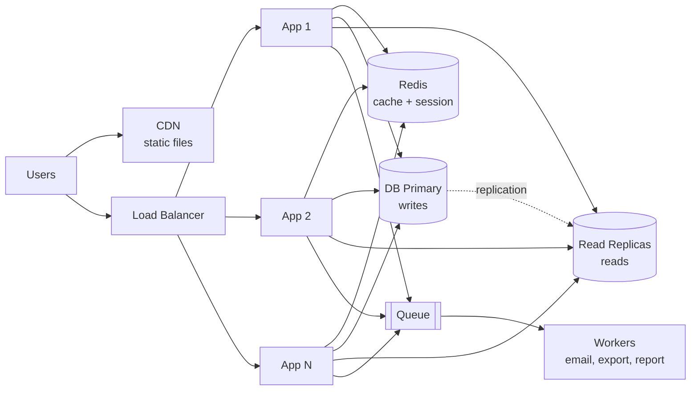

> Tracker ID: SD-02 · Generated: 2026-10-15 · Answers: **SD-Q02** (TRK-02 Phase 1) · Source: general SD knowledge + sokrio-server code (`ScopeCacheToTenant`, `app/Jobs/`) · Status: ✅ generated

# SD-Q02: How would you scale a web app from 1,000 to 1 million users?

> **এক লাইনে:** স্কেলিং মানে একসাথে সব বক্স বসানো না। **মাপো → সবচেয়ে বড় bottleneck খোঁজো → শুধু সেটা ঠিক করো → আবার মাপো।** প্রতিটা ধাপ একটা নির্দিষ্ট ব্যথা দূর করে, আর প্রতিটার একটা খরচ আছে।

---

## ১. প্রথমে সংখ্যাটা বোঝো (৩০ সেকেন্ডের estimation)

"১ মিলিয়ন user" শুনতে বড়, কিন্তু আসল প্রশ্ন হলো **request/sec**।

| ধাপ | হিসাব |
|---|---|
| Total users | 1M |
| Daily active (ধরো ১০–২০%) | ~100K–200K DAU |
| প্রতি user দিনে request | ~20–50 |
| দিনে মোট request | ~2M–10M |
| গড় QPS | 10M / 86,400 ≈ **~100 QPS** |
| Peak (গড়ের ৫–১০×) | **~500–1,000 QPS** |

> **শিক্ষা:** ১০০০ QPS একটা ভালো টিউন করা সিস্টেমে বড় কিছু না। তাই ইন্টারভিউতে বলো: *"1M users is mostly a read-scaling and statelessness problem, not yet a sharding problem."* ইন্টারভিউয়ার এই বিচারটাই দেখতে চায়।

---

## ২. ধাপে ধাপে বিবর্তন



| ধাপ | কখন (লক্ষণ) | কী করো | খরচ / ঝুঁকি |
|---|---|---|---|
| **0. এক সার্ভার** (~1K users) | কিছুই না | App + DB একই মেশিনে | একটা মেশিন পড়লে সব শেষ (single point of failure) |
| **1. DB আলাদা + vertical scale** | CPU/RAM ভরে যাচ্ছে | DB আলাদা সার্ভারে; বড় মেশিন কেনো (**scale up**) | সহজ, কিন্তু সীমা আছে, আর দাম দ্রুত বাড়ে |
| **2. Stateless app + Load Balancer** (~10K–100K) | এক app সার্ভার আর পারছে না | session/file লোকাল ডিস্ক থেকে সরাও (Redis / S3) → LB-র পেছনে N টা app সার্ভার (**scale out**) | session sticky হলে LB ভারসাম্য হারায়; deploy এখন একাধিক মেশিনে |
| **3. Cache + CDN** | একই ডেটা বারবার DB থেকে পড়া হচ্ছে; static ফাইল সার্ভারকে ব্যস্ত রাখছে | Redis-এ hot ডেটা (→ [03-caching.md](03-caching.md)); JS/CSS/ছবি CDN-এ | stale ডেটা, invalidation-এর জটিলতা |
| **4. Read replica** (~100K–1M) | DB CPU বেশি, কিন্তু বেশিরভাগই **read** | Primary = write, replica = read | **Replication lag**: user লিখে সাথে সাথে পড়লে পুরনো ডেটা দেখতে পারে → "read-your-writes"-এর জন্য সেই read primary থেকে করো |
| **5. Queue + worker** | ধীর কাজ (email, export, report) request-কে আটকে রাখছে | কাজটা queue-তে দাও, worker আলাদা স্কেল হয় | eventual completion, retry/duplicate সামলাতে হয় |
| **6. Sharding / partitioning** (1M-এর পরে, **write** bottleneck হলে) | এক primary-র write ক্ষমতা শেষ | ডেটা shard key দিয়ে ভাগ (→ SD-Q04) | cross-shard query/transaction কঠিন; শেষ উপায় |
| **সবসময়** | — | Monitoring (latency p95/p99, error rate, DB CPU, queue length), auto-scaling, health check | না মাপলে ভুল জায়গায় টাকা খরচ |

### সবচেয়ে গুরুত্বপূর্ণ ধারণা: **Stateless server**
App সার্ভারে কোনো user-নির্দিষ্ট অবস্থা (session, upload করা ফাইল, in-memory cart) থাকবে না। তাহলে যেকোনো request যেকোনো সার্ভারে যেতে পারে, সার্ভার যোগ/বাদ দেওয়া সহজ, আর একটা মরে গেলে কেউ টের পায় না।

```ts
// ❌ Stateful: শুধু এই সার্ভারের মেমোরিতে, অন্য সার্ভার জানে না
const sessions = new Map<string, User>();

// ✅ Stateless: সব সার্ভার একই shared store পড়ে
async function getUser(sessionId: string, redis: Redis): Promise<User | null> {
  const raw = await redis.get(`session:${sessionId}`);
  return raw ? JSON.parse(raw) : null;
}
```
Laravel-এ: `.env`-এ `SESSION_DRIVER=redis`, `CACHE_DRIVER=redis`, ফাইল `Storage::disk('s3')`-এ। তাহলে app সার্ভার stateless।

---

## ৩. Vertical vs Horizontal: trade-off টেবিল

| | Vertical (scale up) | Horizontal (scale out) |
|---|---|---|
| কী | বড় মেশিন | বেশি মেশিন |
| সুবিধা | কোড বদলাতে হয় না, সহজ | প্রায় সীমাহীন, একটা পড়লেও চলে (redundancy) |
| অসুবিধা | হার্ডওয়্যারের সীমা, single point of failure | stateless হতে হবে, LB লাগে, distributed সমস্যা |
| কখন | শুরুতে, আর **DB**-র জন্য অনেকদিন | app tier-এ প্রায় সবসময় |

> **ফাঁদ:** প্রথমেই "microservices + Kafka + sharding" বলা। ইন্টারভিউয়ার এটাকে over-engineering ধরবে। সবচেয়ে সস্তা সমাধান দিয়ে শুরু করো, তারপর বলো কোন লক্ষণ দেখলে পরের ধাপে যাবে।

---

## ৪. মুখে বলার লাইন (English)

**ওপেনিং (৩০ সেকেন্ড):**
> "I'd scale in steps, driven by measurements, not all at once. First I'd estimate: one million users is maybe 100K daily active, which is roughly 100 requests per second on average and under a thousand at peak. So this is mostly about read scaling and making the app tier stateless, not sharding yet."

**ধাপগুলো:**
> "Step one, move the database to its own server and scale vertically. That's cheap and buys time. Step two, make the app servers stateless, with sessions in Redis and files in object storage, so I can put several of them behind a load balancer. Step three, add a cache and a CDN, since most traffic is reads. Step four, add read replicas, and send reads that must see the user's own write to the primary to avoid replication lag. Step five, move slow work like emails and exports to a queue with workers. Only when one primary can't handle the writes would I partition or shard."

**Trade-off বাক্য:**
> "I chose horizontal scaling for the app tier over a bigger machine because it also gives redundancy. The cost is that the app must be stateless, which is acceptable because Redis sessions are a small change."

**Wrap-up:**
> "At every step I'd watch p95 latency, error rate, DB CPU and queue depth, and only move to the next step when one of those shows the bottleneck."

---

## ৫. ফলো-আপ প্রশ্ন (ইন্টারভিউয়ার যা খোঁচাবে)

| প্রশ্ন | ছোট উত্তর |
|---|---|
| "Sticky sessions?" | "I'd avoid them. They make load uneven and lose the session when a server dies. Shared session store is better." |
| "How does the load balancer know a server is dead?" | "Health check endpoint, polled every few seconds; failing servers are taken out of rotation." |
| "L4 vs L7 load balancer?" | "L4 routes by IP/port, fast and simple. L7 understands HTTP, so it can route by path or header, terminate TLS, and do smarter health checks." |
| "User writes and immediately doesn't see it. Why?" | "Replication lag on the read replica. Fix: read-your-writes, route that user's reads to the primary for a short time after a write." |
| "What breaks first at 10×?" | "Usually the database: either write throughput on the primary or a few unindexed queries. That's when I'd look at indexes, then partitioning." |

---

🔗 **Sokrio link:**
- **Stateless app tier (কোডে যাচাই করা):** `app/Http/Middleware/ScopeCacheToTenant.php` cache **আর session** দুটোকেই Redis-এ রাখে, প্রতিটা টেন্যান্টের আলাদা key prefix দিয়ে (`tenant_{id}`)। তাই app সার্ভার নিজে কোনো session রাখে না, যেকোনো সার্ভার যেকোনো request নিতে পারে। বলো: *"In Sokrio, sessions and cache live in Redis with a per-tenant prefix, so the API servers are stateless."*
- **Queue + workers:** sokrio-server-এ `app/Jobs/`-এ ১৩২টা job ফাইল, সাবফোল্ডার সহ (report export ইত্যাদি) → ধাপ ৫-এর বাস্তব উদাহরণ (S2, A2)।
- **Data split:** প্রতি টেন্যান্টে আলাদা DB (S3, A1) = এক ধরনের horizontal data partitioning; এক টেন্যান্টের লোড অন্যকে কম ছোঁয়। বিস্তারিত → `5-tracks/system-design/cases/23-multi-tenant-saas.md`।
- **আলাদা read-heavy সার্ভিস:** benchmark-এর cross-tenant read Python সার্ভিসে সরানো (A2, B3) = ভারী read কাজ মূল API থেকে আলাদা করে স্কেল করা।
- ⚠️ **সৎ থাকো:** Sokrio-র production-এ load balancer, কয়টা app সার্ভার, auto-scaling, read replica আছে কি না, কে সেটআপ করেছে: `[Komol পূরণ করবে]`। নিজে না করে থাকলে বলো *"Our infra team/lead handled the load balancer; my part was keeping the app stateless and moving heavy work to queues."*

📚 আরো: `4-library/cs/07-system-design-bd/01-notes.md` · পরের প্রশ্ন: SD-Q03 caching → [03-caching.md](03-caching.md) · SD-Q04 DB scaling
