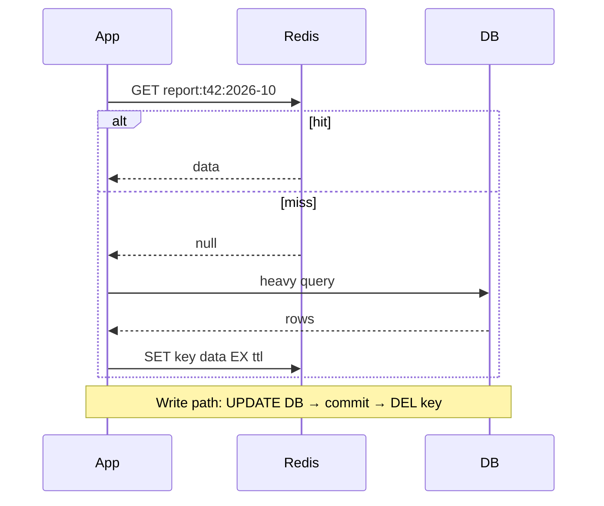

> Tracker ID: SD-03 · Generated: 2026-10-15 · Answers: **SD-Q03** (TRK-02 Phase 1) · Source: general SD knowledge + code (`sokrio-server/app/Http/Middleware/ScopeCacheToTenant.php`, `app/Jobs/KPISummary.php`, `Guest/StockUpdateController.php`, `sokrio-benchmark-python/app/common/cache.py`) · Status: ✅ generated

# SD-Q03: Where would you add a cache, and how do you keep it correct?

> **এক লাইনে:** cache বসানো সহজ, **সঠিক রাখা** কঠিন। ৪টা প্রশ্নের উত্তর দিতে পারলেই ভালো উত্তর: **কোথায় বসাবে, কীভাবে পড়বে/লিখবে, কখন বাতিল (invalidate) করবে, আর একসাথে অনেক miss হলে কী হবে (stampede)।**

---

## ১. কোথায় cache বসে (কাছ থেকে দূরে)

| স্তর | উদাহরণ | কী রাখে | সমস্যা |
|---|---|---|---|
| Browser | HTTP `Cache-Control`, `ETag` | static ফাইল, কিছু GET response | তুমি নিয়ন্ত্রণ হারাও; ভুল header দিলে পুরনো ডেটা আটকে থাকে |
| **CDN** | CloudFront, Cloudflare | JS/CSS/ছবি, public পাতা | user-নির্দিষ্ট ডেটা রাখা যায় না |
| App in-memory | process-এর `Map`, LRU | খুব hot, প্রায় কখনো না-বদলানো ডেটা (config) | প্রতি সার্ভারে আলাদা কপি → সার্ভারগুলোর মধ্যে অমিল |
| **Distributed cache** | **Redis**, Memcached | query result, computed report, session | network hop, invalidation |
| DB নিজে | MySQL buffer pool | পাতা/index | তুমি সরাসরি নিয়ন্ত্রণ করো না |

**কোথায় বসাবে, কীভাবে ঠিক করবে:** যে ডেটা **অনেক বেশি পড়া হয়, কম বদলায়, আর হিসাব করতে দামি**। সূত্র: *read:write অনুপাত বেশি × recompute দামি × কিছুটা পুরনো ডেটা চলে* = ভালো প্রার্থী। ব্যাংক ব্যালান্স (staleness চলে না) = খারাপ প্রার্থী।

---

## ২. পড়া/লেখার pattern

| Pattern | কীভাবে | কখন |
|---|---|---|
| **Cache-aside (lazy loading)** ⭐ সবচেয়ে প্রচলিত | App আগে cache দেখে; miss হলে DB থেকে পড়ে cache-এ রাখে। লেখার সময় DB আপডেট করে **cache key মুছে দেয়** | ডিফল্ট পছন্দ। Laravel `Cache::remember` ঠিক এটাই |
| Read-through | cache লাইব্রেরি নিজেই miss হলে DB থেকে আনে | cache-aside-এর মতোই, লজিক লাইব্রেরিতে |
| Write-through | লেখা একসাথে cache + DB-তে | পড়া খুব বেশি আর সবসময় টাটকা চাই; খরচ: প্রতিটা write ধীর |
| Write-behind (write-back) | আগে cache-এ লেখা, পরে ব্যাচে DB-তে | counter, analytics; ঝুঁকি: cache পড়লে ডেটা হারায় |
| Write-around | শুধু DB-তে লেখা, cache miss-এ ভরে | যে ডেটা লেখার পরে কম পড়া হয় |



---

## ৩. সঠিক রাখা: Invalidation

> "There are only two hard things in computer science: cache invalidation and naming things." এটা ইন্টারভিউতে বলে হাসাতে পারো, তারপর সিরিয়াস উত্তর দাও।

| কৌশল | কীভাবে | ভালো | খারাপ |
|---|---|---|---|
| **TTL** | key একটা সময় পরে নিজেই মরে | সহজ, শেষমেশ ঠিক হয়ে যায় | TTL পর্যন্ত পুরনো ডেটা |
| **Write-এ delete** | DB আপডেট → commit → `DEL key` | প্রায় তাৎক্ষণিক টাটকা | সব জায়গায় key মনে রাখতে হয় যেগুলো এই ডেটা ব্যবহার করে |
| **Versioned key** | key-তে version: `product:42:v7`; বদলালে version বাড়ে | পুরনো key আর কেউ পড়ে না, race নেই | পুরনো key TTL পর্যন্ত মেমোরিতে থাকে |
| **Event-driven** | DB change → event → listener key মোছে | অনেক সার্ভিসের cache একসাথে | event হারালে stale |

**মনে রাখার নিয়ম:**
1. **Update না, delete করো।** দুটো write একসাথে হলে cache-এ ভুল মান বসতে পারে; delete করলে পরের read টাটকা মান আনে।
2. **DB commit-এর পরে delete করো**, আগে না। আগে মুছলে commit-এর আগেই কেউ পুরনো মান আবার cache-এ বসিয়ে দিতে পারে। (Laravel-এ `DB::afterCommit` বা transaction শেষে forget)
3. **সবসময় একটা TTL রাখো**, delete-ভিত্তিক invalidation থাকলেও। কোনো bug-এ delete মিস হলে TTL নিরাপত্তা জাল।
4. **Multi-tenant হলে key-তে tenant থাকতেই হবে।** না থাকলে এক ক্লায়েন্টের ডেটা অন্যজন দেখবে = security incident।

---

## ৪. তিনটা ক্লাসিক বিপদ

| বিপদ | কী হয় | সমাধান |
|---|---|---|
| **Cache stampede** (thundering herd) | জনপ্রিয় key-র TTL শেষ → একসাথে ১০০০ request miss → সবাই DB-তে একই ভারী query → DB পড়ে যায় | **Lock / single-flight**: শুধু একজন recompute করে, বাকিরা অপেক্ষা করে বা পুরনো মান পায় · **Stale-while-revalidate**: পুরনো মান দাও, পেছনে refresh · **TTL jitter**: TTL-এ র‍্যান্ডম ±১০% যাতে সব key একসাথে না মরে · ভারী ডেটা **আগেই গরম (pre-warm)** করো |
| **Hot key** | একটা key-তে এত traffic যে একটা Redis node-ই আটকে যায় | app-এর ভেতরে ছোট L1 in-memory cache (কয়েক সেকেন্ড), key-র কপি একাধিক node-এ (`key#1..#N`) |
| **Cache penetration** | এমন key চাওয়া যা DB-তেও নেই → প্রতিবার miss → DB-তে যায় (আক্রমণও হতে পারে) | "নেই" ফলাফলও ছোট TTL দিয়ে cache করো · Bloom filter |

### কোড: stampede-নিরাপদ cache-aside (TypeScript)

```ts
async function remember<T>(
  key: string,
  ttlSec: number,
  compute: () => Promise<T>,
): Promise<T> {
  const hit = await redis.get(key);
  if (hit) return JSON.parse(hit);

  // শুধু একজন recompute করবে (SET NX = key না থাকলেই সেট)
  const lockKey = `lock:${key}`;
  const gotLock = await redis.set(lockKey, '1', 'EX', 30, 'NX');
  if (!gotLock) {
    await sleep(100);                      // অন্য কেউ হিসাব করছে
    return remember(key, ttlSec, compute); // আবার চেষ্টা (বাস্তবে max retry দাও)
  }
  try {
    const value = await compute();
    const jitter = Math.floor(ttlSec * 0.1 * Math.random()); // সব key একসাথে না মরে
    await redis.set(key, JSON.stringify(value), 'EX', ttlSec + jitter);
    return value;
  } finally {
    await redis.del(lockKey);
  }
}
```

**Laravel-এ একই জিনিস:**
```php
// সাধারণ cache-aside
$data = Cache::remember("report:{$tenantId}:{$month}", 10800, fn () => $service->build($month));

// stampede থেকে বাঁচাতে lock
Cache::lock("report-build:{$tenantId}:{$month}", 30)->block(10, function () { /* recompute */ });

// write path: commit-এর পরে মুছে দাও
DB::transaction(function () use ($order) { $order->save(); });
Cache::forget("order:{$tenantId}:{$order->id}");
```
> Laravel 11+-এ `Cache::flexible()` = বিল্ট-ইন stale-while-revalidate। Sokrio Laravel 10-এ, তাই নেই।

---

## ৫. মুখে বলার লাইন (English)

**মূল উত্তর (৬০ সেকেন্ড):**
> "I'd cache data that is read far more than it's written and is expensive to compute, as long as a little staleness is acceptable. My default is cache-aside in Redis: read from cache, on a miss compute and store with a TTL. On writes I update the database, and after the commit I delete the key rather than update it, so concurrent writes can't leave a wrong value. I always keep a TTL as a safety net, even with explicit invalidation."

**Stampede:**
> "The classic failure is a stampede: a hot key expires and a thousand requests hit the database at once. I'd put a lock around the recompute so only one request rebuilds it, add jitter to TTLs, and for very hot data serve the stale value while one worker refreshes it."

**TTL কীভাবে ঠিক করো:**
> "TTL is a business decision: how fast does the data really change, and how expensive is a recompute? Monthly benchmark data doesn't change hourly, so a three-hour TTL was fine there."

**Multi-tenant:**
> "In a multi-tenant system every key must carry the tenant id. A cache key without tenant scope isn't a performance bug, it's a data leak."

---

## ৬. ফলো-আপ প্রশ্ন

| প্রশ্ন | ছোট উত্তর |
|---|---|
| "Why delete instead of update on write?" | "Two concurrent writers can finish in a different order in the cache than in the DB, leaving a stale value until TTL. Delete is idempotent and the next read rebuilds from the source of truth." |
| "Redis goes down. What happens?" | "Cache must be optional: fall back to the DB, with a circuit breaker so we don't hammer Redis, and expect higher DB load. That's why the DB must survive a cold cache, at least briefly." |
| "Cache a failed or partial result?" | "No. If the computation timed out or degraded, skip writing it, otherwise you serve the failure for the full TTL." (Sokrio-তে ঠিক এটাই আছে, নিচে দেখো) |
| "Redis vs Memcached?" | "Redis: data structures, persistence, locks, pub/sub. Memcached: simpler, pure key-value, multi-threaded. I'd default to Redis." |
| "How do you know the cache helps?" | "Track hit rate, p95 latency with and without hit, and DB load. A cache with 20% hit rate is mostly complexity." |

---

🔗 **Sokrio link:** (সব কোডে যাচাই করা, 2026-10-15)
- **TTL সিদ্ধান্ত (A2, S2):** benchmark category cache TTL 600s → 10800s = ১৮× কম recompute; মাসিক ডেটা, ৩ ঘণ্টা staleness ব্যবসায়িকভাবে চলে।
- **Failed result cache না করা:** `sokrio-benchmark-python/app/common/cache.py`-এর `cache_remember(..., should_cache=...)`: query timeout হয়ে খালি fallback এলে সেটা Redis-এ **লেখে না**, যাতে পরের request আবার চেষ্টা করে। খুব ভালো ইন্টারভিউ পয়েন্ট। `git log`-এ `app/common/cache.py`-এর একমাত্র লেখক **Komol** (যাচাই 2026-10-15) → *"I built"* বলতে পারো।
- **Tenant-scoped key:** `ScopeCacheToTenant` middleware প্রতিটা টেন্যান্টের cache/session-কে আলাদা prefix দেয় (`tenant_{id}`)। **Gotcha (A1):** prefix শুধু HTTP request-এ বসে, queue job-এ না। তাই নিয়ম: key-তে tenant নিজে বসাও, middleware-এর ওপর ভরসা না।
- **Lock (stampede/duplicate প্রতিরোধ):** `app/Jobs/KPISummary.php`-এ `Cache::lock("kpi_summary_lock:{db}")` = একই টেন্যান্টের KPI দুই worker একসাথে হিসাব করে না · `Guest/StockUpdateController.php`-এ challan-প্রতি lock = একই stock update দুবার চলে না।
- ⚠️ **সৎ ফাঁক:** Python `cache_remember`-এ **stampede lock নেই** (কোডে দেখা)। প্রশ্ন এলে বলো: *"Our benchmark cache doesn't have stampede protection today; given the fan-out cost, the next thing I'd add is a Redis lock around the recompute plus TTL jitter."* এটা দুর্বলতা না, পরিপক্বতা দেখায়।

📚 আরো: `4-library/cs/08-kafka-redis-rabbitmq/01-notes.md` (Redis অংশ) · `0-now/hm-qbank.md` B6 · আগের প্রশ্ন: [02-scaling.md](02-scaling.md)
