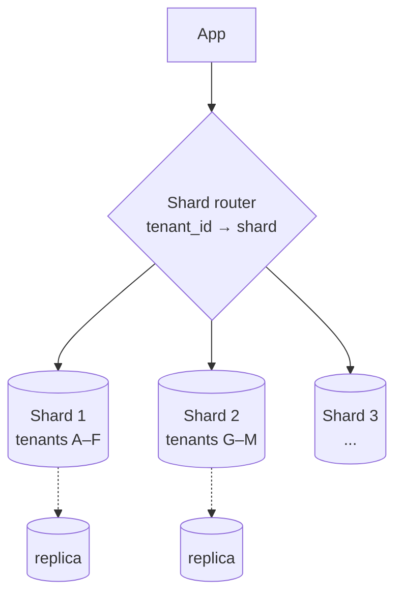

> Tracker ID: SD-04 · Generated: 2026-10-15 · Answers: **SD-Q04** (TRK-02 Phase 2) · Source: general SD knowledge + sokrio-server code (`config/database.php` `read` connection, `TenantManager::reconnect('read')` in 27 job/report files, `git log`) · Status: ✅ generated

# SD-Q04: One MySQL server is not enough anymore. What do you do?

> **এক লাইনে:** সাথে সাথে sharding না। **সস্তা থেকে দামি** ক্রমে যাও: আগে মাপো কোনটা ভরেছে (read? write? storage? connections?), তারপর query/index ঠিক করো → বড় মেশিন → cache → read replica → partitioning → শেষ উপায় sharding। প্রতিটা ধাপ পরেরটার চেয়ে কম জটিল।

---

## ১. প্রথম প্রশ্ন: "Not enough" মানে ঠিক কী?

| লক্ষণ | কী মাপবে | সাধারণ কারণ |
|---|---|---|
| Query ধীর | slow query log, `EXPLAIN`, p95 latency | index নেই, N+1, `SELECT *`, বড় `OFFSET` |
| CPU ১০০% | কোন query সবচেয়ে বেশি CPU খায় (performance_schema) | কয়েকটা খারাপ query, বা read অনেক বেশি |
| Write আটকে যাচ্ছে | lock wait, replication lag, disk IOPS | বড় transaction, hot row, এক primary-র সীমা |
| Storage ভরে যাচ্ছে | টেবিল সাইজ | পুরনো ডেটা কখনো archive হয় না |
| "Too many connections" | active connection সংখ্যা | app সার্ভার বেড়েছে, pool নেই |

> **ইন্টারভিউর মূল কথা:** *"First I'd find out which resource is exhausted, because each one has a different fix."* এটা বললেই তুমি আলাদা হয়ে যাও।

---

## ২. সিঁড়ি: সস্তা থেকে দামি

| # | ধাপ | কী করে | খরচ / ঝুঁকি |
|---|---|---|---|
| 1 | **Query + index ঠিক করা** | `EXPLAIN` দেখে composite index (`(tenant_id, created_at)`), N+1 দূর, cursor/keyset pagination (`WHERE id > ?` বনাম `OFFSET 100000`) | প্রায় বিনামূল্যে; প্রায়ই ১০–১০০× লাভ। index বেশি হলে write ধীর |
| 2 | **Vertical scaling** | বড় RAM (পুরো working set buffer pool-এ), দ্রুত SSD | কোড বদলায় না; সীমা আর দাম |
| 3 | **Connection pooling** | ProxySQL / RDS Proxy / app-level pool | ছোট ops খরচ |
| 4 | **Cache** | বারবার পড়া ডেটা Redis-এ (→ [03-caching.md](03-caching.md)) | staleness, invalidation |
| 5 | **Read replica** | Primary = write, এক বা একাধিক replica = read (রিপোর্ট, লিস্ট) | **Replication lag**; read-your-writes-এর জন্য সেই read primary থেকে |
| 6 | **ভারী কাজ আলাদা করা** | রিপোর্ট/analytics আলাদা replica বা আলাদা store-এ (pre-aggregated summary, data warehouse) | দুই জায়গায় ডেটা, sync |
| 7 | **Archiving** | পুরনো ডেটা (২ বছরের অর্ডার) আলাদা টেবিল/cold storage-এ | পুরনো ডেটা খোঁজা কঠিন |
| 8 | **Partitioning** (এক সার্ভারের ভেতরে) | MySQL `PARTITION BY RANGE (YEAR(created_at))`: বড় টেবিল ভেতরে ভাগ | query-তে partition key না থাকলে লাভ নেই |
| 9 | **Vertical split (functional)** | আলাদা ডোমেইনের টেবিল আলাদা DB-তে (orders DB, users DB) | cross-DB join নেই |
| 10 | **Sharding** (horizontal, একাধিক সার্ভার) | একই টেবিলের row ভাগ: `shard = hash(tenant_id) % N` | cross-shard query/transaction কঠিন, resharding কষ্টকর, ops ভারী → **শেষ উপায়** |

---

## ৩. Replication: সংক্ষেপে

| ধরন | কীভাবে | trade-off |
|---|---|---|
| **Async** (MySQL ডিফল্ট) | primary commit করে, পরে replica-তে যায় | দ্রুত write; primary মরলে শেষ কয়েক সেকেন্ডের ডেটা হারাতে পারে; lag |
| **Semi-sync** | কমপক্ষে একটা replica পাওয়া স্বীকার করলে commit | নিরাপদ, write একটু ধীর |
| Failover | primary মরলে replica-কে primary বানানো (RDS Multi-AZ, Orchestrator) | split-brain ঝুঁকি, app-কে নতুন host জানতে হয় |

**Replication lag সামলানো:** (১) user নিজের লেখা পড়লে primary থেকে, (২) কয়েক সেকেন্ডের "sticky to primary" window, (৩) রিপোর্টের মতো কাজ যেখানে কয়েক সেকেন্ড পুরনো চলে, সেখানে replica নিরাপদ।

---

## ৪. Sharding: shard key কীভাবে বাছবে ⭐

ভালো shard key-এর ৩ গুণ:
1. **বেশিরভাগ query-তে থাকে** → এক shard-এই query শেষ (cross-shard scatter-gather না)
2. **সমানভাবে ছড়ায়** → কোনো shard "hot" না
3. **একসাথে লাগা ডেটা একসাথে রাখে** → transaction এক shard-এ

| কৌশল | উদাহরণ | ভালো | খারাপ |
|---|---|---|---|
| Hash | `hash(user_id) % N` | সমান বণ্টন | range query ছড়িয়ে যায়; N বদলালে সব সরে → **consistent hashing** লাগে |
| Range | `created_at` মাস অনুযায়ী | range query সহজ | নতুন ডেটা সব এক shard-এ = **hot shard** |
| Directory / lookup | `tenant → shard` টেবিল | নমনীয়, বড় টেন্যান্ট আলাদা সরানো যায় | lookup টেবিল নিজেই dependency (cache করো) |

**SaaS-এ স্বাভাবিক shard key = `tenant_id`**: প্রায় সব query এক টেন্যান্টের, টেন্যান্টের ডেটা একসাথে থাকে। বিপদ: একটা বিশাল টেন্যান্ট (whale) → তাকে নিজের shard-এ সরাও (directory approach)।

---

## ৫. মুখে বলার লাইন (English)

**মূল উত্তর (৬০ সেকেন্ড):**
> "First I'd find out what's actually exhausted: CPU, write throughput, storage or connections, because each has a different fix. Usually it's a handful of slow queries, so I'd start with the slow query log and EXPLAIN, fix indexes and pagination. That's nearly free. Then a bigger machine and a cache. If reads dominate, read replicas, sending reports and lists there and keeping read-your-writes on the primary. Heavy analytics I'd move off the transactional database entirely, into pre-aggregated summaries. Partitioning and archiving handle big tables. Sharding is the last step, because it makes cross-shard queries, transactions and rebalancing hard."

**Shard key:**
> "In a multi-tenant SaaS the natural shard key is tenant id: nearly every query is scoped to one tenant, so it stays on one shard. The risk is one huge tenant, so I'd use a lookup table from tenant to shard, which lets me move a big tenant onto its own shard."

**Trade-off বাক্য:**
> "I'd choose read replicas over sharding at this stage because our bottleneck is reads. The cost is replication lag, which is fine for reports that can be a few seconds old."

---

## ৬. ফলো-আপ প্রশ্ন

| প্রশ্ন | ছোট উত্তর |
|---|---|
| "Why is OFFSET pagination slow?" | "MySQL still reads and throws away all the skipped rows. Keyset pagination, `WHERE id > last_id LIMIT 50`, uses the index and stays fast." |
| "Partitioning vs sharding?" | "Partitioning splits a table inside one server, transparent to the app. Sharding splits data across servers, and the app or a router must know where each row lives." |
| "How do you add a shard later?" | "With consistent hashing or a directory, only a slice of keys moves. You copy data, dual-write or replay changes, then switch the mapping." |
| "Cross-shard query, like a global report?" | "Scatter-gather across shards and merge, or better, stream changes into a separate analytics store built for that." |
| "Primary dies?" | "Promote a replica, automatically with something like RDS Multi-AZ. With async replication you can lose the last few seconds, so semi-sync if that's unacceptable." |

---

🔗 **Sokrio link:** (কোডে যাচাই করা, 2026-10-15)
- **Read connection (ধাপ ৫):** `config/database.php`-এ আলাদা `read` connection (`READ_DB_HOST`)। **২৭টা** job/report ফাইল ভারী রিপোর্টের আগে `TenantManager::tenant($org)->reconnect('read')` করে (যেমন `StockDownloadJOb`, `AttendanceReportJob`, `GenerateOrderProductSummery`)। মানে ভারী রিপোর্টের read মূল write DB থেকে সরানো। config ২০২২-এ Miraj যোগ করেছে; তোমার ৬টা commit এই অংশ ছুঁয়েছে। `READ_DB_HOST` production-এ আসলেই আলাদা replica কি না: `[Komol পূরণ করবে]`। বলো: *"Our heavy report jobs switch to a read connection before they run, so exports don't compete with order writes."*
- **Per-tenant DB = tenant_id দিয়ে sharding-এর রূপ (S3, A1):** প্রতি টেন্যান্টের আলাদা MySQL DB, landlord DB হলো directory (কোন টেন্যান্ট কোন DB/host)। তাই "shard key কী হবে?" প্রশ্নের উত্তর তুমি বাস্তবে দেখেছ। খরচ: migration সব টেন্যান্টে চালাতে হয়, cross-tenant রিপোর্ট fan-out লাগে (A2)।
- **Analytics আলাদা store-এ (ধাপ ৬, S2):** রিপোর্টের জন্য MongoDB-তে pre-aggregated summary (`order_summaries`, `DeliverySummary`) + `order_rollups_monthly`।
- **Index (ধাপ ১, A2):** benchmark-এ আলাদা index script + `--check` (সব active টেন্যান্টে index gap শূন্য কি না)। per-tenant DB-তে প্রতিটা টেন্যান্টের index অবস্থা আলাদা হতে পারে, এটা ভালো গল্প।
- ⚠️ ব্যক্তিগতভাবে partitioning/sharding চালু করেছ? না হলে বলো: *"I haven't sharded a single database myself; our per-tenant databases gave us that split by design."*

📚 আরো: `4-library/cs/02-relational-database/` · আগে: [03-caching.md](03-caching.md) · পরে: [05-sql-vs-nosql.md](05-sql-vs-nosql.md)
