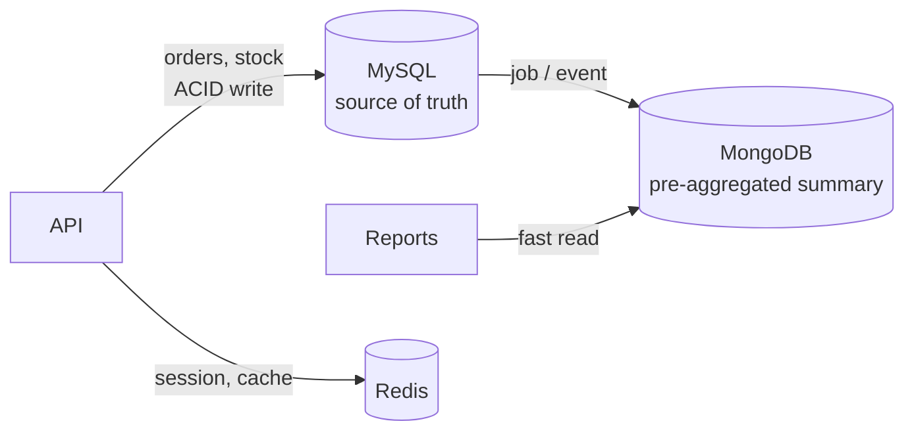

> Tracker ID: SD-05 · Generated: 2026-10-15 · Answers: **SD-Q05** (TRK-02 Phase 2) · Source: general SD knowledge + `0-now/hm-qbank.md` A2, A5, B2 + sokrio-server `app/Models/MongoDB/` · Status: ✅ generated

# SD-Q05: SQL or NoSQL? When do you choose each?

> **এক লাইনে:** প্রশ্নটা "কোনটা ভালো" না। প্রশ্ন হলো **ডেটার আকার আর access pattern কী**। সম্পর্কযুক্ত ডেটা + transaction + অজানা ভবিষ্যৎ query → **SQL (ডিফল্ট)**। জানা access pattern + নমনীয় আকার + বিশাল write/scale → **NoSQL**।

---

## ১. মূল পার্থক্য

| | **SQL** (MySQL, PostgreSQL) | **NoSQL** |
|---|---|---|
| ডেটা মডেল | টেবিল + row, স্থির schema | Document (MongoDB), Key-value (Redis, DynamoDB), Wide-column (Cassandra), Graph (Neo4j) |
| সম্পর্ক | JOIN + foreign key | সাধারণত embed বা ডেটা কপি (denormalize) |
| Transaction | পূর্ণ **ACID**, একাধিক টেবিল জুড়ে | প্রায়ই এক document/key-তে atomic (Mongo-তে multi-doc tx আছে কিন্তু দামি) |
| Schema | migration লাগে | নমনীয়, প্রতিটা document আলাদা আকারের হতে পারে |
| Query | যেকোনো প্রশ্ন (ad-hoc), SQL | access pattern আগে থেকে জেনে ডিজাইন করতে হয় |
| Scale | vertical + replica সহজ; sharding কঠিন | অনেকগুলো বিল্ট-ইন horizontal scale/sharding নিয়ে তৈরি |
| Consistency | strong (ডিফল্ট) | প্রায়ই tunable / eventual (→ SD-Q06) |

> **ভুল ধারণা:** "NoSQL = দ্রুত"। এক সার্ভারে ভালো index-ওয়ালা MySQL অনেক দ্রুত। NoSQL-এর আসল সুবিধা হলো **নমনীয়তা আর horizontal scale**, গতি নিজে থেকে না।

---

## ২. সিদ্ধান্তের চেকলিস্ট

**SQL বেছে নাও যখন:**
- টাকা, অর্ডার, স্টক: একাধিক row/টেবিল একসাথে বদলাতে হয় (**transaction**)
- entity-গুলোর মধ্যে অনেক সম্পর্ক, JOIN লাগবে (user ↔ order ↔ product ↔ territory)
- ভবিষ্যতে কী query লাগবে জানো না (রিপোর্টিং, ad-hoc প্রশ্ন)
- ডেটার integrity জরুরি (FK, unique, constraint)

**NoSQL বেছে নাও যখন:**
- access pattern সরল আর জানা: "id দিয়ে পুরো object আনো"
- আকার ভিন্ন ভিন্ন বা প্রায়ই বদলায় (প্রতিটা ফর্মের আলাদা ফিল্ড, event payload)
- বিশাল write ভলিউম, append-only (log, GPS ping, event, IoT)
- আগেই হিসাব করা (pre-aggregated) read model, যেটা একবারে পুরো পড়া হয়
- key-value: session, cache, counter (Redis)

| ধরন | কখন | উদাহরণ |
|---|---|---|
| Document (MongoDB) | নমনীয় nested ডেটা, পুরো document একসাথে পড়া | প্রোডাক্ট ক্যাটালগ, ফর্ম রেসপন্স, রিপোর্ট summary |
| Key-value (Redis, DynamoDB) | key দিয়ে খুব দ্রুত get/set | session, cache, rate-limit counter |
| Wide-column (Cassandra) | বিশাল write, time-series | GPS/location ping, metrics |
| Graph (Neo4j) | সম্পর্কই মূল প্রশ্ন | "friends of friends", recommendation |

---

## ৩. Polyglot persistence: একসাথে দুটোই ⭐

বাস্তব সিস্টেমে প্রায়ই দুটো একসাথে: **MySQL = source of truth (transaction), NoSQL = দ্রুত read model / cache / log।**



**খরচ:** দুই ডেটাবেসের ops, ডেটা sync (summary পুরনো হতে পারে), দুইরকম skill। তাই প্রতিটা নতুন জিনিসের জন্য আলাদাভাবে বিচার করো, "আমরা Mongo ব্যবহার করি" বলে সব Mongo-তে না।

### Mini example: একই ডেটা, দুই আকার

```ts
// SQL: normalized, JOIN দিয়ে জোড়া
// orders(id, outlet_id, created_at) + order_items(order_id, product_id, qty, price)
// SELECT ... FROM orders JOIN order_items ... WHERE outlet_id = ?

// Document: পুরো order একটা document-এ, এক read-এ সব
type OrderDoc = {
  _id: string;
  outlet: { id: number; name: string };      // কপি করা (denormalized)
  items: { productId: number; qty: number; price: number }[];
  createdAt: Date;
};
// ✅ "এই order দেখাও" এক read-এ
// ❌ "এই product-এর নাম বদলাও" → হাজার document-এ কপি আপডেট
```

---

## ৪. মুখে বলার লাইন (English)

**মূল উত্তর (৬০ সেকেন্ড):**
> "I start from the data and its access patterns, not the technology. If the data is relational, needs multi-row transactions, like orders and stock, or I don't know all future queries yet, I default to SQL. I'd pick a document store when the shape varies, access is mostly 'fetch the whole thing by key', or I need high write volume and horizontal scale. In practice I often use both: SQL as the source of truth, and a NoSQL store for pre-computed read models, cache or logs."

**Sokrio উদাহরণ (সবচেয়ে শক্তিশালী অংশ):**
> "In Sokrio, orders and stock live in MySQL because they need transactions. Reports read from pre-aggregated summaries in MongoDB, because each report reads a whole summary document and the shape differs per report. And when I built Task Manager, I deliberately chose MySQL even though similar modules like claims were in Mongo, because tasks are low-volume and need heavy joins with users, departments and territories."

**Trade-off বাক্য:**
> "Using both MySQL and MongoDB costs us two systems to operate and a sync lag on summaries, which is acceptable because reports can be slightly stale but orders can't be wrong."

---

## ৫. ফলো-আপ প্রশ্ন

| প্রশ্ন | ছোট উত্তর |
|---|---|
| "MongoDB has transactions now. Why not use it for everything?" | "It does, but multi-document transactions are costlier and the ecosystem around joins, constraints and ad-hoc reporting is weaker. For relational, transactional data SQL is still the simpler choice." |
| "Embed or reference in MongoDB?" | "Embed when the child is read with the parent and bounded in size, like order items. Reference when it's shared, large or grows without limit." |
| "How do you keep MySQL and Mongo in sync?" | "Either a scheduled job rebuilds the summary, or change events (outbox/CDC) update it. Scheduled is simpler; events are fresher." |
| "Schema-less means no schema?" | "No, the schema just lives in the application. You still need validation and migrations for old documents." |
| "When is Postgres a better SQL choice than MySQL?" | "Richer types like JSONB, better complex queries and extensions. MySQL is simpler to operate and very common. Either is fine for most apps." |

---

🔗 **Sokrio link:**
- **Polyglot (S2, A2, B2):** MySQL = orders/users/stock (transaction); MongoDB = pre-aggregated `order_summaries`, `DeliverySummary`, `order_rollups_monthly` (রিপোর্ট দ্রুত); Redis = cache/session। `app/Models/MongoDB/`-এ Claim, Complaint, CheckIn, DailyAttendance ইত্যাদি document model।
- **তোমার নিজের বিচার (A5, সবচেয়ে ভালো প্রমাণ):** Task Manager-এ Mongo-র precedent থাকা সত্ত্বেও **MySQL** বেছে নেওয়া: কম ভলিউম + `users`/`departments`/`territories`-এর সাথে ভারী join। এটা দেখায় তুমি টেকনোলজি না, ডেটা দেখে সিদ্ধান্ত নাও।
- **Sync কৌশল (A2 L3):** rollup **scheduled job**, event-driven না, যাতে Laravel আর Python benchmark সার্ভিস কাপল না হয়।

📚 আরো: `4-library/cs/02-relational-database/` · আগে: [04-db-scaling.md](04-db-scaling.md) · পরে: SD-Q06 CAP + consistency (P3)
