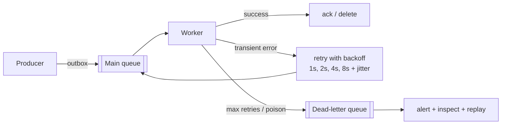

> Tracker ID: SD-07 · Generated: 2026-10-15 · Answers: **SD-Q07** (TRK-02 Phase 3) · Source: general SD knowledge + `4-library/cs/08-kafka-redis-rabbitmq/` + sokrio-server code (`config/queue.php`, `app/Jobs/SMS/ResendFailedSmsBatch.php`, `app/Contracts/Kafka/`, `git log`) · Status: ✅ generated

# SD-Q07: When and why would you use a message queue? How do you handle failures in it?

> **এক লাইনে:** Queue বসাও যখন কাজটা **এখনই, request-এর ভেতরে** করার দরকার নেই, বা প্রযোজক (producer) আর ভোক্তা (consumer)-কে **আলাদা গতিতে** চলতে দিতে চাও। আর ধরে নাও: **message দুবার আসবে, দেরিতে আসবে, ভুল ক্রমে আসবে, বা কখনো process হবে না।** ভালো উত্তর মানে এই চারটা সামলানো।

---

## ১. কেন queue (৫টা কারণ)

| কারণ | উদাহরণ |
|---|---|
| **ধীর কাজ request থেকে সরানো** | রিপোর্ট export, ইমেইল, PDF, ছবি resize → user সাথে সাথে "processing" পায় |
| **Spike শোষণ (buffer)** | সকাল ৯টায় ১০,০০০ অর্ডার; worker নিজের গতিতে খায়, DB পড়ে যায় না |
| **Decoupling** | Order সার্ভিস জানে না কে কে order event শোনে (SMS, stock, analytics) |
| **Retry** | provider ডাউন → message queue-তে থাকে, পরে আবার চেষ্টা |
| **Fan-out** | এক event → অনেক consumer (Kafka topic / pub-sub) |

**কখন না:** user-এর **এখনই** উত্তর দরকার (login, stock আছে কি না), বা সিস্টেম ছোট আর queue-এর ops খরচ লাভের চেয়ে বেশি।

---

## ২. Queue vs Log: RabbitMQ vs Kafka (vs Redis queue)

| | **Task queue** (RabbitMQ, SQS, Laravel Redis queue) | **Log / stream** (Kafka) |
|---|---|---|
| মডেল | message খাওয়া হলে মুছে যায় | message log-এ থাকে (retention), consumer নিজের **offset** রাখে |
| Consumer | একটা কাজ একজন worker পায় | অনেক **consumer group** একই event আলাদাভাবে পড়ে |
| Replay | না | হ্যাঁ, offset পিছিয়ে আবার পড়া যায় |
| Ordering | সাধারণত গ্যারান্টি নেই | **partition-এর ভেতরে** ক্রম ঠিক (key = order_id → একই partition) |
| ভালো | job/task (email পাঠাও, রিপোর্ট বানাও), routing | event stream, উচ্চ throughput, অনেক consumer, audit/replay |
| খরচ | সহজ | ops ভারী (broker, partition, rebalancing) |

---

## ৩. Delivery guarantee

| গ্যারান্টি | মানে | কখন |
|---|---|---|
| At-most-once | হারাতে পারে, দুবার না | metrics, লগ (হারালে ক্ষতি কম) |
| **At-least-once** ⭐ ডিফল্ট | হারাবে না, কিন্তু **দুবার** আসতে পারে | প্রায় সব কাজ |
| Exactly-once | ঠিক একবার | আসলে **at-least-once + idempotent consumer** = "effectively once" |

> **মূল বাক্য:** *"Exactly-once delivery is mostly a myth across systems; I design for at-least-once and make consumers idempotent."*

**Idempotent consumer কীভাবে:**
- message-এ unique id → `processed_messages(message_id UNIQUE)` টেবিলে insert; duplicate হলে skip
- বা কাজটাই স্বাভাবিকভাবে idempotent: `SET status='sent' WHERE id=? AND status='pending'` (দ্বিতীয়বার 0 row)
- বাইরের API কল হলে তাদেরকেও idempotency key পাঠাও

---

## ৪. Failure সামলানো ⭐ (প্রশ্নের দ্বিতীয় অংশ)

| সমস্যা | সমাধান |
|---|---|
| **Transient error** (timeout, 503) | **Exponential backoff + jitter** দিয়ে retry, সর্বোচ্চ N বার |
| **Permanent error / poison message** (খারাপ ডেটা, প্রতিবার crash) | retry না করে **Dead-letter queue (DLQ)**; alert; ঠিক করে replay |
| **Worker মাঝপথে মরে** | ack শুধু কাজ **শেষে** দাও; visibility timeout / `retry_after` পরে message আবার আসে → তাই idempotent হতে হবে |
| **Duplicate** | idempotent consumer (ওপরে) |
| **Ordering** | ক্রম দরকার হলে একই key একই partition-এ; না হলে consumer-এ version/sequence চেক |
| **Producer: DB-তে লিখল কিন্তু publish ব্যর্থ** (dual write) | **Outbox pattern**: event একই DB transaction-এ `outbox` টেবিলে, আলাদা relay publish করে |
| **Queue জমে যাচ্ছে** (consumer ধীর) | queue depth / consumer lag monitoring + alert, worker auto-scale, **backpressure** (producer ধীর করা) |
| **Downstream ডাউন** (SMS provider) | circuit breaker: বারবার চেষ্টা না করে কিছুক্ষণ থামাও, message ফেরত রাখো |

---

## ৫. মুখে বলার লাইন (English)

**কখন/কেন:**
> "I use a queue when work doesn't need to finish inside the user's request, or when producers and consumers need to run at different speeds: exports, emails, notifications, absorbing traffic spikes, and decoupling services so the order service doesn't know who listens to order events. I'd pick a simple task queue for jobs, and a log like Kafka when many consumers need the same events, ordering per key, or replay."

**Failure (মূল অংশ):**
> "I assume at-least-once delivery, so every consumer must be idempotent: a unique message id, or a conditional status update that does nothing the second time. Transient errors get retries with exponential backoff and jitter; after a limit, or for a poison message, it goes to a dead-letter queue with an alert. I only acknowledge after the work is done. On the producer side I use the outbox pattern so a database write and its event can't get out of sync. And I monitor queue depth and consumer lag."

**নিজের গল্প (SMS resend, তোমার লেখা):**
> "When I built bulk resend of failed SMS, the queue job could crash halfway, so the rows themselves carry the state. Rows are claimed from failed to pending, and each one moves to processing right before the provider call. If a batch dies, pending rows go back to failed and stay resendable, but processing rows are marked 'delivery unknown' instead of retried, because the provider may have already sent them. I set the queue's own tries to one and keep our own retry count on the message, so a retry is always a deliberate, visible action and a customer never gets the same SMS twice by accident."

---

## ৬. ফলো-আপ প্রশ্ন

| প্রশ্ন | ছোট উত্তর |
|---|---|
| "Kafka vs RabbitMQ?" | "RabbitMQ for task distribution and flexible routing; Kafka for high-throughput event streams with many consumers and replay." |
| "How do you keep order per customer?" | "Partition by customer id so their events go to one partition and one consumer in order." |
| "What's in your DLQ alert?" | "Count, oldest age, error reason. Then a runbook: fix the cause, replay from DLQ." |
| "Why not retry forever?" | "A poison message blocks or burns resources forever. Bounded retries, then DLQ." |
| "Queue is down when you publish?" | "With outbox the event waits in the DB. Without it, fail the request or roll back what you claimed." (SMS resend ঠিক এটা করে: queue unreachable হলে claimed row ফেরত `failed`) |

---

🔗 **Sokrio link:** (কোডে যাচাই করা, 2026-10-15)
- ⭐ **তোমার নিজের:** `app/Services/SMS/MessageResendService.php` + `app/Jobs/SMS/ResendFailedSmsBatch.php` (Komol, 2026-10-05…08):
  - status দিয়ে claim (`failed → pending → processing`) = idempotent; ডাবল ক্লিক → 409
  - `$tries = 1`, নিজের `retry_count` (`config/sms.php` `max_retry` = 5) → ইচ্ছাকৃত retry
  - `failed()` hook + `releaseRows()`: crash হলে `pending` → `failed` (আবার পাঠানো যাবে), `processing` → `failed` + "Delivery unknown" (দুবার পাঠানোর ঝুঁকি নেয় না)
  - queue unreachable হলে claim ফেরত দেয় (dispatch-এর catch)
  - আলাদা queue `sms-resend`, batch size 100
- **Laravel queue:** `config/queue.php` Redis connection; `app/Jobs/`-এ ১৩২টা job ফাইল (সাবফোল্ডার সহ), তার ৭৬টায় `$tries`/`backoff`/`ShouldBeUnique`/`failed()` কিছু আছে।
- **Kafka (টিমের):** `app/Contracts/Kafka/` (Producer/Consumer/Factory/TopicRegistry), tracking action → লেখক sihab (১৯), Rakib (১৩) → বলো *"our team's Kafka layer; I worked with it"*।
- ⚠️ **RabbitMQ:** লোকাল কোনো Sokrio রিপোতে RabbitMQ কোড নেই (handoff-এর ঝুঁকি), অথচ CV/S1 বলে RabbitMQ। ইন্টারভিউর আগে **Truth Audit**-এ ঠিক করো কী বলবে: `[Komol পূরণ করবে]`।

📚 আরো: `4-library/cs/08-kafka-redis-rabbitmq/01-notes.md` · আগে: [06-cap-consistency.md](06-cap-consistency.md)
